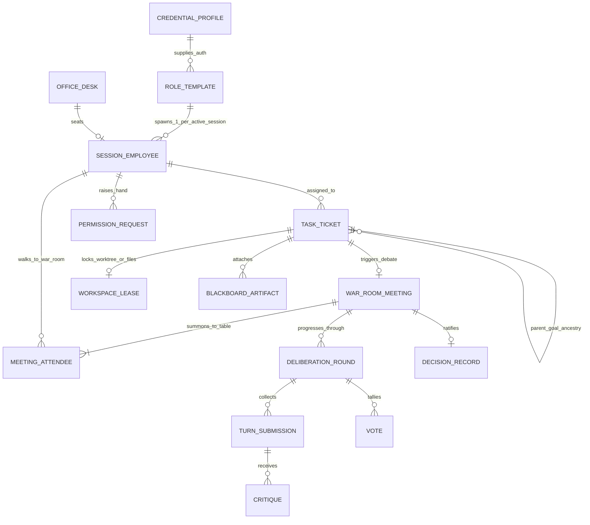
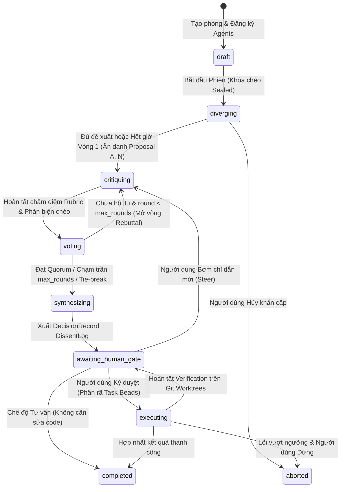

# Data Model: Factory Multi-Agent Arena

**Feature**: `001-multi-agent-arena` | **Date**: 2026-11-13

Mô hình thực thể và lược đồ trạng thái dưới đây được thiết kế cho cơ sở dữ liệu **SQLite (WAL mode)** kết hợp sổ cái sự kiện bất biến (**Append-Only JSONL Ledger**).

---

## 1. Sơ đồ Quan hệ Thực thể (Entity Relationship Overview — Virtual Office & Deliberation Arena)

---

## 2. Chi tiết các Thực thể Cốt lõi

### 2.1. `CredentialProfile` (Hồ sơ Xác thực Bảo mật)
Lưu trữ khóa kết nối tách biệt hoàn toàn khỏi không gian ngữ cảnh của Agent.

| Trường | Kiểu dữ liệu | Bắt buộc | Mô tả & Quy tắc kiểm tra |
|---|---|---|---|
| `id` | `TEXT (ULID)` | Có | Định danh hồ sơ (ví dụ: `cred_01J...`). |
| `label` | `TEXT` | Có | Tên gợi nhớ hiển thị trên UI (ví dụ: `OpenAI Architect Key`, `Local Ollama`). |
| `provider_kind` | `ENUM` | Có | `openai_compatible` \| `anthropic` \| `gemini` \| `ollama` \| `a2a_bearer` \| `mcp_token`. |
| `base_url` | `TEXT` | Không | Endpoint tùy chỉnh; kiểm tra chặn SSRF/loopback trái phép nếu là remote. |
| `encrypted_secret` | `BLOB` | Có | Chuỗi bí mật mã hóa bằng `AES-256-GCM` kèm `iv` (12 bytes) và `auth_tag` (16 bytes). |
| `rate_limit_rpm` | `INTEGER` | Không | Giới hạn số yêu cầu mỗi phút (`> 0`). |
| `max_cost_usd` | `REAL` | Không | Trần ngân sách tối đa cho phép trên mỗi phiên (`>= 0`). |
| `created_at` | `ISO8601` | Có | Thời điểm khởi tạo. |

---

### 2.2. `RoleTemplate` & `SessionEmployee` (Ánh xạ 1 Session AI = 1 Nhân viên Văn phòng 3D)

Tách biệt giữa **Khung Chức danh (`RoleTemplate`)** trong Sơ đồ Tổ chức (Org Chart) và **Phiên Nhân viên Đang chạy (`SessionEmployee`)** để khi mở 3 cửa sổ IDE/CLI khác nhau sẽ hiện đúng **3 nhân viên độc lập ngồi tại 3 bàn làm việc riêng**.

**`RoleTemplate` (Vị trí trong Sơ đồ Tổ chức)**:
- `id` (`role_01J...`), `department` (`leadership` | `architecture` | `backend` | `frontend` | `security_qa` | `devops`), `job_title` (ví dụ: `Principal Architect`, `Backend Engineer`, `Red-Team Reviewer`), `reports_to_role_id` (`FK` tự tham chiếu tạo Org Chart), `avatar_preset` (màu áo, phụ kiện 3D), `default_capabilities_json`, `monthly_budget_usd`.

**`SessionEmployee` (Nhân viên Phiên AI — Thực thể sống 1:1 với mỗi Active Session)**:

| Trường | Kiểu dữ liệu | Bắt buộc | Mô tả & Quy tắc kiểm tra |
|---|---|---|---|
| `id` | `TEXT (ULID)` | Có | Định danh duy nhất của Nhân viên Phiên (`emp_01J...`). |
| `session_fingerprint` | `TEXT (UNIQUE)` | Có | Khóa định danh phiên bền vững (ghép từ `transport + workspace_uri + client_session_id`) giúp tự động gắn lại đúng bàn khi IDE reload. |
| `role_template_id` | `TEXT (FK)` | Có | Tham chiếu `RoleTemplate.id`. |
| `employee_code` | `TEXT` | Có | Mã nhân viên ngắn để `@mention` và gán trên thẻ Kanban (ví dụ: `MSW-01`, `VSC-FE-02`, `API-SEC-03`). |
| `display_name` | `TEXT` | Có | Tên hiển thị trên đầu nhân vật 3D (ví dụ: `Minh (MSW Tech Lead)`, `Lan (Cursor Frontend)`). |
| `transport_type` | `ENUM` | Có | `mcp_bridge` \| `acp_editor` \| `api_key` \| `cli_pty` \| `a2a_remote`. |
| `model_identifier` | `TEXT` | Không | Hiển thị trên thẻ Inspector cho Giám đốc nhưng bị che hoàn toàn với các nhân viên khác khi họp phản biện ẩn danh. |
| `credential_id` | `TEXT (FK)` | Không | Tham chiếu `CredentialProfile.id` (nếu chạy qua `api_key`). |
| `desk_slot_id` | `TEXT` | Có | Mã bàn làm việc trong Văn phòng 3D (ví dụ: `DESK-B2`, `LEAD-01`). |
| `spatial_zone` | `ENUM` | Có | `at_desk` \| `walking_to_war_room` \| `at_war_room_table` \| `at_kanban_wall` \| `lounge_offline`. |
| `avatar_pose` | `ENUM` | Có | `idle` \| `typing_code` \| `reading_files` \| `running_tests` \| `speaking` \| `hand_raised` \| `budget_paused`. |
| `active_ticket_id` | `TEXT (FK)` | Không | Phiếu việc hiện tại đang mở trên màn hình bàn làm việc của nhân viên. |
| `context_fill_pct` | `REAL` | Có | Phần trăm độ đầy cửa sổ ngữ cảnh của phiên (`0..100`); cảnh báo vàng khi `> 40%`. |
| `session_cost_usd` | `REAL` | Có | Chi phí lũy kế của riêng nhân viên phiên này (`>= 0`). |
| `last_tool_call_summary` | `TEXT` | Không | Dòng trạng thái thật hiển thị trong bong bóng suy nghĩ / Inspector Card (ví dụ: `editing src/router.ts`). |
| `last_heartbeat_at` | `ISO8601` | Có | Cập nhật liên tục từ MCP/ACP/PTY/Worker; quá 30s không phản hồi tự động báo mất kết nối. |

---

### 2.3. `TaskTicket` & `PermissionRequest` (Bảng Kanban Công ty & Hiệu ứng ✋ Giơ tay)

**`TaskTicket` (Phiếu việc trên Bảng Kanban — hợp nhất quản lý công việc & `TaskBead`)**:
- `id` (`TSK-101`, `ULID`), `parent_ticket_id` (`FK` tạo cây Goal Ancestry: Company Goal $\to$ Epic $\to$ Task Bead), `title`, `description_markdown`, `acceptance_criteria_json`.
- `kanban_column`: `backlog` | `assigned` | `in_progress` | `in_war_room_debate` | `in_review` | `director_gate` | `done` | `blocked`.
- `priority`: `p0_critical` | `p1_high` | `p2_normal` | `p3_low`.
- `assignee_session_id` (`FK SessionEmployee` — nhân viên chịu trách nhiệm chính tại bàn).
- `reviewer_session_ids_json` (danh sách các nhân viên phản biện chéo).
- `repo_root_path`, `base_branch`, `retry_count` (phục vụ Ralph-style clean retry).

**`PermissionRequest` (Sự kiện ✋ Giơ tay xin quyền ngay trong Văn phòng 3D)**:
- `id` (`perm_01J...`), `session_employee_id` (`FK`), `ticket_id` (`FK`), `request_kind` (`shell_command` | `destructive_git` | `budget_topup` | `clarification_question`), `prompt_summary` (`TEXT`), `risk_level` (`low` | `medium` | `high`), `status` (`pending` | `allowed` | `denied` | `answered`), `resolved_by` (`director_ui` | `lead_agent`), `created_at`, `resolved_at`.

---

### 2.4. `WarRoomMeeting` (Phòng Họp Phản biện 3D — kế thừa thực thể `Room`)
Không gian phiên họp phản biện gắn trực tiếp với một `TaskTicket` hoặc chủ đề kiến trúc, nơi các `SessionEmployee` rời bàn cá nhân vào ngồi quanh bàn họp.

| Trường | Kiểu dữ liệu | Bắt buộc | Mô tả & Quy tắc kiểm tra |
|---|---|---|---|
| `id` | `TEXT (ULID)` | Có | Định danh phòng (`room_01J...`). |
| `title` | `TEXT` | Có | Chủ đề thảo luận hoặc nhiệm vụ kỹ thuật. |
| `repo_root_path` | `TEXT` | Không | Đường dẫn tuyệt đối tới Git repository đang phối hợp. |
| `base_branch` | `TEXT` | Không | Nhánh gốc đối chiếu (ví dụ: `main` hoặc `001-multi-agent-arena`). |
| `protocol_mode` | `ENUM` | Có | `council` \| `adversarial` \| `roundtable` \| `execution_mesh`. |
| `status` | `ENUM` | Có | `draft` \| `diverging` \| `critiquing` \| `voting` \| `awaiting_human_gate` \| `synthesizing` \| `executing` \| `completed` \| `aborted`. |
| `moderator_id` | `TEXT` | Có | `SessionEmployee.id` hoặc `"human"` giữ vai trò điều phối tổng hợp. |
| `linked_ticket_id` | `TEXT (FK)` | Không | Tham chiếu `TaskTicket.id` phát sinh cuộc họp phản biện này. |
| `config_json` | `JSON` | Có | `{ max_rounds: 3, turn_timeout_sec: 90, quorum_ratio: 0.67, tie_breaker: "moderator" \| "human", budget_tokens: 250000, anonymize_proposals: true }`. |
| `consumed_tokens` | `INTEGER` | Có | Tổng token tiêu thụ cộng dồn của cả phòng (`>= 0`). |
| `consumed_cost_usd` | `REAL` | Có | Tổng chi phí ước tính cộng dồn (`>= 0`). |
| `created_at` | `ISO8601` | Có | Thời điểm mở phòng. |

---

### 2.5. `DeliberationRound` & `TurnSubmission` (Vòng Tranh luận & Đề xuất)

**`DeliberationRound`**:
- `id` (`ULID`), `room_id` (`FK WarRoomMeeting`), `round_number` (`INTEGER >= 1`), `stage` (`proposal` | `critique` | `rebuttal` | `vote` | `synthesis`), `visibility_state` (`sealed` — khóa chéo khi đang thu thập đề xuất vòng 1 | `anonymized` — chỉ hiện nhãn ẩn danh | `revealed` — đã mở danh tính ở bước tổng hợp), `started_at`, `closed_at`.

**`TurnSubmission`**:
- `id` (`ULID`), `round_id` (`FK DeliberationRound`), `session_employee_id` (`FK SessionEmployee`), `anonymous_alias` (`TEXT`, ví dụ `"Proposal A"`, sinh ngẫu nhiên mỗi phòng bằng Fisher-Yates shuffle), `summary` (`TEXT <= 1500 chars` dùng cho Context Builder), `content_markdown` (`TEXT`), `citations_json` (`JSON` mảng `{ path, line_start, line_end, artifact_id }`), `token_usage_json` (`{ prompt, completion }`), `latency_ms` (`INTEGER`), `submitted_at` (`ISO8601`).
- **Ràng buộc cốt lõi**: Khi `DeliberationRound.visibility_state = 'sealed'`, API/MCP truy vấn từ Nhân viên Phiên `X` chỉ trả về bài nộp của chính `X`; mọi bài nộp của `Y != X` bị lọc bỏ hoàn toàn ở tầng cơ sở dữ liệu/service.

---

### 2.6. `Critique` & `Vote` (Bản Phản biện Chéo & Phiếu bầu)

**`Critique`**:
- `id` (`ULID`), `round_id` (`FK DeliberationRound`), `reviewer_session_id` (`FK SessionEmployee`), `target_submission_id` (`FK TurnSubmission`).
- `rubric_scores_json`: `{ correctness: 1..10, security: 1..10, maintainability: 1..10, feasibility: 1..10 }`.
- `findings_json`: Mảng các phát hiện có cấu trúc `[{ severity: "critical"|"high"|"medium"|"low", category: "logic"|"security"|"performance"|"edge_case", claim: "...", evidence_ref: "src/auth.ts:42" }]`.
- `strengths_summary` (`TEXT`), `blind_spots_summary` (`TEXT`).
- **Quy tắc kiểm tra**: Không cho phép `reviewer_session_id` chấm điểm chính bài của mình nếu chế độ cấu hình bật `exclude_self_scoring = true`. Mọi phát hiện mức `critical` hoặc `high` bắt buộc phải có `evidence_ref` hoặc đánh dấu tường minh là giả thuyết.

**`Vote`**:
- `id` (`ULID`), `round_id` (`FK DeliberationRound`), `voter_session_id` (`FK SessionEmployee`), `ranked_choices_json` (mảng thứ tự ưu tiên `["sub_01...", "sub_02..."]`), `confidence` (`REAL 0.0..1.0`), `rationale` (`TEXT`).

---

### 2.7. `DecisionRecord` & `BlackboardArtifact` (Biên bản Quyết định & Hiện vật Bảng đen)

**`BlackboardArtifact`**:
- `id` (`art_01J...`), `room_id` (`FK WarRoomMeeting`, tùy chọn), `ticket_id` (`FK TaskTicket`, tùy chọn), `author_session_id` (`FK SessionEmployee`), `kind` (`spec` | `architecture_diagram` | `code_diff` | `test_report` | `log_excerpt` | `decision_record`), `title`, `mime_type`, `storage_path`, `sha256_hash`, `byte_size`, `compact_digest` (`TEXT <= 600 chars` luôn nạp sẵn vào chỉ mục phòng), `version` (`INTEGER >= 1`).

**`DecisionRecord`**:
- `id` (`dec_01J...`), `room_id` (`FK WarRoomMeeting`), `winning_submission_id` (`FK TurnSubmission`), `resolution_method` (`supermajority` | `ranked_choice` | `moderator_tiebreak` | `human_override`), `final_plan_markdown` (`TEXT`), `adopted_amendments_json` (các ý hay được gộp từ phương án thua), `dissent_log_json` (danh sách các phản biện bảo lưu chưa đồng thuận kèm điều kiện kích hoạt xem xét lại), `human_approved_by` (`TEXT`), `approved_at` (`ISO8601`).

---

### 2.8. `WorkspaceLease` & Hạt nhân Thực thi Bead trên `TaskTicket`

Mỗi `TaskTicket` mức lá (atomic implementation bead sinh ra từ `DecisionRecord` thông qua `decision_id` và `depends_on_tickets_json`) khi được một `SessionEmployee` nhận thực thi sẽ gắn 1-1 với một bản ghi `WorkspaceLease`:

**`WorkspaceLease`**:
- `id` (`lease_01J...`), `ticket_id` (`FK TaskTicket` — alias tương thích `bead_id` ở tầng giao thức), `session_employee_id` (`FK SessionEmployee`), `isolation_mode` (`git_worktree` | `file_lock`), `worktree_path` (`TEXT`), `branch_name` (`TEXT`), `locked_globs_json` (ví dụ `["packages/protocol/**"]`), `expires_at` (`ISO8601`), `released_at` (`ISO8601`).
- **Quy tắc bất biến**: Hai `WorkspaceLease` đang hiệu lực (`released_at IS NULL AND expires_at > NOW()`) trong cùng một `repo_root_path` không được phép giao nhau trên tập `locked_globs_json` nếu dùng chung nhánh làm việc.

---

## 3. Máy Trạng thái Phiên làm việc (Room Lifecycle State Transitions)

