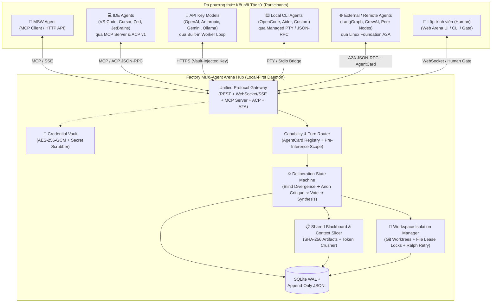
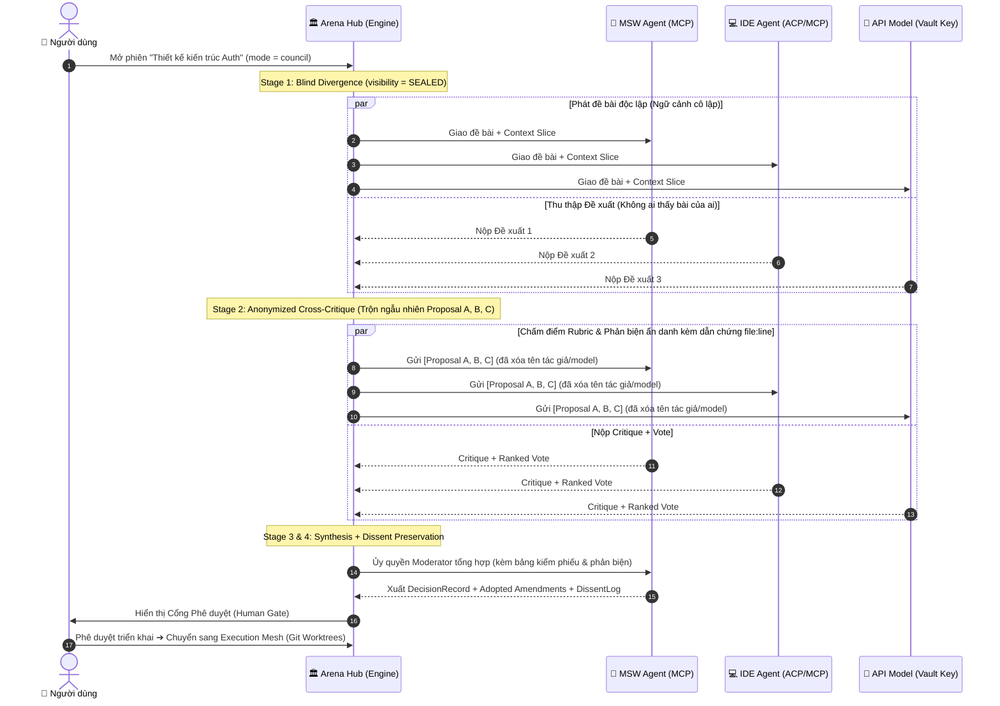

# Implementation Plan: Môi trường Hợp tác, Phản biện và Điều phối Đa Agent Đa phương thức (Factory Multi-Agent Arena)

**Branch**: `001-multi-agent-arena` | **Date**: 2026-11-13 | **Spec**: [spec.md](./spec.md)

**Input**: Feature specification from `/specs/001-multi-agent-arena/spec.md` & Prior-art research from `/.specify/assessments/multi-agent-arena/research.md`

## Summary

Xây dựng **Factory Virtual Office & Multi-Agent Arena** — một nền tảng điều phối công việc và phản biện đa tác tử ưu tiên chạy cục bộ (Local-First Hub mở rộng lên Team Server), nơi **mỗi phiên làm việc đang chạy (Active Session) của bất kỳ AI nào** (phiên **MSW Agent**, từng cửa sổ **IDE** như VS Code/Cursor/Zed/JetBrains qua **MCP** & **ACP**, tiến trình **CLI**, các Worker qua **API Key**, và **Remote Agent chuẩn A2A**) được ánh xạ **1-1 thành một Nhân viên AI (`SessionEmployee`)** trong không gian **Phòng làm việc 3D hoạt hình** kết hợp **Bảng Quản lý Task (Kanban & Org Chart)**.
- **Tại bàn làm việc cá nhân (Engineering Desks)**: Mỗi nhân viên nhận phiếu việc (`TaskTicket`), thao tác trên nhánh **Git Worktree cô lập** (hoặc `FileLease`), hiển thị trực tiếp thao tác gọi công cụ, thanh độ đầy bộ nhớ (`Context Fill %`), đồng hồ chi phí (`Payroll Meter`) và **✋ Giơ tay xin quyền** để người dùng duyệt ngay trên giao diện 3D.
- **Tại Phòng Họp Kính 3D (War Room / Conference Table)**: Khi cần thiết kế hoặc thẩm định chéo, các nhân viên rời bàn bước vào phòng họp thực hiện **Hội đồng Phản biện 4 bước (Blind Divergence → Anonymized Cross-Critique → Weighted Voting → Synthesis + Dissent Log)** trước khi đưa Biên bản Quyết định lên **Bàn Giám đốc (Human Director Gate)** ký duyệt.

## Technical Context

**Language/Version**: TypeScript 5.7+ trên Node.js 22 LTS (tương thích runtime Bun 1.2+); quản lý gói bằng `pnpm` workspaces.

**Primary Dependencies**:
- **Core Hub & Realtime API**: `hono` (hoặc `fastify`), `ws` (WebSocket đồng bộ trạng thái không gian 3D `< 30ms`), Server-Sent Events (SSE), `zod`.
- **Interoperability Protocols**: `@modelcontextprotocol/sdk` (MCP Server & Client bridge cho IDE/MSW Agent), `@agentclientprotocol/sdk` (ACP JSON-RPC v1 bridge cho code editors), chuẩn JSON-RPC 2.0 `AgentCard` cho A2A.
- **Storage & Security**: `better-sqlite3` + `drizzle-orm` (SQLite WAL mode), `node:crypto` (`AES-256-GCM` + `scrypt`/OS Keyring cho Credential Vault).
- **3D Animated Virtual Office & Kanban UI (`apps/web-arena`)**: React 19 + Vite + **Three.js / `@react-three/fiber` + `@react-three/drei`** (kết xuất Phòng làm việc 3D isometric/low-poly 60fps: bàn nhân viên, màn hình code phát sáng, nhân vật đi bộ từ bàn vào Phòng Họp Kính, bong bóng trạng thái & ✋ Giơ tay) + `@dnd-kit/core` (kéo-thả Bảng Kanban giao việc cho nhân viên) + chế độ chuyển đổi tức thì 3D Office $\leftrightarrow$ 2D Kanban/Council View.

**Storage**: SQLite ở chế độ WAL (`.factory-arena/arena.db`) cho trạng thái quan hệ/khóa tệp + Append-Only JSONL (`.factory-arena/events/<room-id>.jsonl`) cho sổ cái sự kiện bất biến + Kho tệp hiện vật định địa chỉ theo băm SHA-256 (`.factory-arena/artifacts/`).

**Testing**: `vitest` cho Unit & Contract Tests (kiểm định JSON Schema MCP/A2A/Debate), Playwright cho E2E Web Arena UI, và bộ kiểm thử tích hợp đa tiến trình thực tế (In-process MCP Client + Local Mock/Loopback LLM Server + Real Temporary Git Repositories/Worktrees, tuyệt đối không mock tầng khóa tệp và máy trạng thái).

**Target Platform**: Đa nền tảng Linux, macOS, Windows (WSL2 & Native) dưới dạng Local Daemon + CLI (`factory-arena`) + Web UI + MCP/ACP IDE Bridge; hỗ trợ đóng gói Docker Compose khi chạy chế độ Team Hub.

**Project Type**: Multi-package Monorepo (`web-service` + `cli` + `protocol-sdk` + `ide-bridge` + `web-ui`).

**Performance Goals**:
- Độ trễ định tuyến sự kiện nội bộ (Hub Event Bus → WebSocket/SSE/MCP subscriber): `< 30ms` p95.
- Truy vấn & kiểm tra xung đột `WorkspaceLease` trên SQLite WAL: `< 5ms` p99.
- Hỗ trợ đồng thời `2–12` Agent hoạt động song song trong một phòng và tối thiểu `10` phòng hoạt động trên một máy trạm phát triển tiêu chuẩn.

**Constraints**:
- Không rò rỉ chéo dữ liệu ở vòng `Blind Divergence` (cưỡng chế ở tầng truy vấn dữ liệu, không dựa vào lời dặn prompt).
- Không bao giờ xuất chuỗi API Key ra log, sự kiện SSE/WebSocket, bảng đen hay ngữ cảnh của bất kỳ Agent nào (`Zero Secret Exposure`).
- Tiết kiệm tối thiểu `50%` lượng token ngữ cảnh từ vòng tranh luận thứ 3 nhờ cơ chế tóm tắt theo vòng và con trỏ `artifact://`.

**Scale/Scope**: Bản v1 tập trung vào quy mô cá nhân & nhóm kỹ thuật nhỏ (`1–20` lập trình viên, kho mã nguồn tới `500k+ LOC`, phiên làm việc kéo dài nhiều giờ với khả năng khôi phục đầy đủ sau khi khởi động lại daemon).

## Constitution Check

*GATE: Must pass before Phase 0 research. Re-check after Phase 1 design.*

| Nguyên tắc Hiến pháp (`constitution.md`) | Trạng thái Pre-Design | Giải pháp Thiết kế Đáp ứng (Post-Phase 1 Verification) | Trạng thái Post-Design |
|---|---|---|---|
| **I. Protocol-First & Multi-Transport Agnosticism** | ✅ PASS | Tách gói `packages/adapters` chuẩn hóa 5 kết nối (`api_key`, `mcp_bridge`, `acp_editor`, `cli_pty`, `a2a_remote`) qua giao diện `ParticipantAdapter` và schema `AgentCard`. | ✅ PASS |
| **II. Structured Deliberation & Anti-Groupthink** | ✅ PASS | `DeliberationEngine` cưỡng chế khóa `sealed` ở vòng 1, trộn ngẫu nhiên `Proposal A..N` ở vòng 2, chấm Rubric có bằng chứng và bắt buộc sinh `DissentLog` trong `DecisionRecord`. | ✅ PASS |
| **III. Workspace & Execution Isolation** | ✅ PASS | `WorktreeManager` cấp nhánh Git worktree riêng cho mỗi `TaskBead` và `LeaseRegistry` khóa glob tệp có TTL + heartbeat cho IDE Agent. | ✅ PASS |
| **IV. Context Hygiene & Event-Sourced Ledger** | ✅ PASS | Tách sổ cái JSONL bất biến khỏi `PromptContextBuilder`; tự động đẩy payload `> 2KB` sang `BlackboardArtifact` và nén log nhiễu. | ✅ PASS |
| **V. Security, Zero Secret Leakage & Human Gates** | ✅ PASS | Kho khóa `CredentialVault` mã hóa `AES-256-GCM`, bộ lọc biên đầu ra (secret scrubber) và trạng thái `awaiting_human_gate` bắt buộc trước khi thực thi/merge. | ✅ PASS |

*Kết luận Gate*: Đạt 5/5 nguyên tắc cốt lõi, không có vi phạm cần ngoại lệ.

## Project Structure

### Documentation (this feature)

```text
specs/001-multi-agent-arena/
├── plan.md                                  # Kế hoạch triển khai kỹ thuật tổng thể
├── research.md                              # Quyết định kiến trúc & lựa chọn công nghệ (Phase 0)
├── data-model.md                            # Lược đồ dữ liệu, thực thể & máy trạng thái (Phase 1)
├── quickstart.md                            # Kịch bản chạy kiểm chứng đầu-cuối (Phase 1)
├── checklists/
│   └── requirements.md                      # Bảng kiểm chất lượng đặc tả (16/16 Passed)
└── contracts/                               # Hợp đồng giao tiếp đa phương thức (Phase 1)
    ├── arena-http-api.openapi.yaml          # REST + SSE API cho Hub, Rooms, Vault, Gates
    ├── mcp-arena-tools.json                 # Bộ công cụ MCP để MSW Agent & IDEs tham gia phòng
    ├── a2a-agent-card.schema.json           # JSON Schema chuẩn Agent2Agent (A2A) & ACP Bridge
    └── deliberation-protocol.schema.json    # Schema gói tin Đề xuất, Phản biện Rubric, Vote & Decision
```

### Source Code (repository root)

```text
packages/
├── protocol/                  # Schemas (Zod + JSON Schema), sự kiện chuẩn, kiểu dữ liệu dùng chung
│   └── src/
│       ├── ledger-events.ts
│       ├── session-employee.ts
│       ├── kanban-workspace.ts
│       ├── deliberation.ts
│       ├── a2a-card.ts
│       └── mcp-contracts.ts
├── core/                      # Bộ máy trung tâm: Office Roster, Deliberation Engine, Blackboard, Worktrees
│   └── src/
│       ├── office/            # office-roster.service.ts, payroll-budget.service.ts, heartbeat-scheduler.ts
│       ├── engine/            # council.ts, adversarial.ts, roundtable.ts, voting.ts
│       ├── blackboard/        # artifact-store.ts, context-slicer.ts, log-crusher.ts
│       ├── workspace/         # kanban-task.service.ts, git-worktree-manager.ts, file-lease-registry.ts, ralph-retry.ts
│       ├── storage/           # sqlite-db.ts, event-ledger.ts, schema/{employees,tickets,deliberation}.ts
│       └── security/          # credential-vault.ts, secret-scrubber.ts, ssrf-guard.ts
├── adapters/                  # Đa phương thức kết nối Agent vào Văn phòng 3D & Arena
│   └── src/
│       ├── adapter.interface.ts
│       ├── api-key/           # api-key-adapter.ts (OpenAI-compatible, Anthropic, Gemini, Ollama)
│       ├── mcp-bridge/        # mcp-arena-server.ts, mcp-kanban-tools.ts, mcp-council-tools.ts
│       ├── acp-editor/        # acp-bridge.ts (Agent Client Protocol v1 cho trình soạn thảo)
│       ├── cli-pty/           # pty-supervisor.ts (quản lý CLI agents cục bộ)
│       └── a2a-remote/        # a2a-adapter.ts (/.well-known/agent.json & JSON-RPC client)
└── cli/                       # Lệnh `factory-arena` (start, vault, employee, room, connect-ide)
    └── src/
        └── index.ts

apps/
├── hub-server/                # HTTP + WebSocket + SSE + MCP Streamable HTTP Daemon
│   └── src/
│       ├── server.ts
│       ├── routes/            # participants.ts, tickets.ts, rooms.ts, artifacts.ts, gates.ts, vault.ts
│       └── ws/                # realtime-stream.ts
├── web-arena/                 # Phòng làm việc 3D hoạt hình + Kanban Task Board + Phòng Họp (React 19 + R3F/Three.js)
│   └── src/
│       ├── scene3d/           # OfficeScene3D.tsx, EmployeeAvatar.tsx, GlassWarRoom.tsx
│       ├── kanban/            # KanbanBoard.tsx, OrgChartTree.tsx
│       ├── council/           # CritiqueMatrix.tsx, DissentPanel.tsx, DecisionMinutesModal.tsx
│       └── inspector/         # EmployeeInspectorDrawer.tsx, DirectorDeskHUD.tsx
└── vscode-bridge/             # Extension mỏng tự động đăng ký MCP/ACP & hiển thị thanh trạng thái Nhân viên
    └── src/
        └── extension.ts

tests/
├── contract/                  # us1-session-employee-contracts.spec.ts, us2-kanban-lease-contracts.spec.ts, us3-deliberation-mcp-contracts.spec.ts
├── integration/               # foundation-vault-ledger.spec.ts, us1-office-sessions.spec.ts, us2-worktree-isolation.spec.ts, us3-council-deliberation.spec.ts
└── e2e/                       # virtual-office-arena.e2e.ts
```

**Structure Decision**: Chọn kiến trúc **Modular Monorepo (`packages/*` + `apps/*`)** tách bạch rõ ràng lõi máy trạng thái điều phối (`packages/core`), định nghĩa giao thức (`packages/protocol`) và các đầu cắm kết nối (`packages/adapters`). Cách tổ chức này tuân thủ triệt để nguyên tắc *Library-First & Protocol-First*: có thể nhúng `packages/core` chạy độc lập qua CLI, chạy như một MCP Server duy nhất cho IDE/MSW Agent, hoặc bật đầy đủ `apps/hub-server` + `apps/web-arena` cho trải nghiệm phòng họp trực quan.

## Architectural Blueprint & Multi-Modal Connection Flows

### 1. Sơ đồ Kiến trúc Tổng thể (Multi-Transport Topology)



### 2. Luồng Phản biện Hội đồng Chống Thiên kiến (4-Stage Council Sequence)



### 3. Lộ trình Triển khai theo Giai đoạn (Phased Delivery Milestones)

1. **Milestone 1 — Core Ledger, Vault & API Key Adapter (MVP Hạt nhân)**:
   - Hoàn thiện `packages/protocol`, SQLite WAL + JSONL Event Ledger, `CredentialVault` (`AES-256-GCM`), và `APIKeyAdapter` (OpenAI/Anthropic/Gemini/Ollama) chạy được phiên Hội đồng 4 bước qua CLI.
2. **Milestone 2 — Universal MCP & ACP Bridge (Kết nối MSW Agent & Đa IDE)**:
   - Xuất bản `mcp-arena-server` (Streamable HTTP + stdio proxy) và `acp-bridge`. Kết nối trực tiếp **MSW Agent**, **VS Code / Cursor / Zed** vào chung phòng phản biện thời gian thực mà không cần trích xuất API Key của IDE.
3. **Milestone 3 — Workspace Isolation & Parallel Execution Mesh**:
   - Triển khai `GitWorktreeManager`, `FileLeaseRegistry`, phân rã `DecisionRecord` thành DAG `TaskBead` và cơ chế phục hồi `Ralph-Style Clean Retry`.
4. **Milestone 4 — Web Arena UI, CLI/PTY Supervisor & A2A Federation**:
   - Xây dựng giao diện trực quan `apps/web-arena` (bảng so sánh phản biện, biểu đồ đồng thuận, Human Gate, quản lý chi phí) và cổng liên thông `A2A` (`/.well-known/agent.json`) cho Agent từ xa.

## Complexity Tracking

> Không có vi phạm Constitution Check. Mọi thành phần trong Monorepo đều ánh xạ 1-1 tới các yêu cầu chức năng cốt lõi (`FR-001` → `FR-010`).

