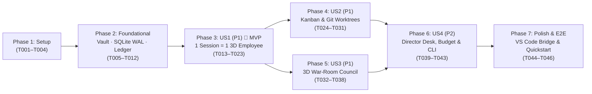

---

description: "Actionable, dependency-ordered task list for Factory Virtual Office & Multi-Agent Arena"
---

# Tasks: Văn phòng 3D Quản lý Task & Phản biện Đa Agent — Mỗi AI Session là một Nhân viên (Factory Virtual Office & Arena)

**Input**: Design documents from `/specs/001-multi-agent-arena/` (`plan.md`, `spec.md`, `research.md`, `data-model.md`, `contracts/`, `quickstart.md`) and `.specify/memory/constitution.md`

**Prerequisites**: `plan.md` (TypeScript 5.7+ / Node.js 22 LTS `pnpm` Monorepo, Hono + WS/SSE, SQLite WAL + JSONL Ledger, `@modelcontextprotocol/sdk`, `@agentclientprotocol/sdk`, React 19 + Three.js/R3F), `spec.md` (4 prioritized User Stories: `US1` P1, `US2` P1, `US3` P1, `US4` P2)

**Tests**: Bao gồm các đầu việc kiểm thử hợp đồng giao thức (`tests/contract/`) và kiểm thử tích hợp thực tế không dùng mock (`tests/integration/`) theo bắt buộc của `.specify/memory/constitution.md` (mục *Development Workflow & Quality Gates*).

**Organization**: Các đầu việc được nhóm theo từng User Story để mỗi giai đoạn có thể triển khai, kiểm thử độc lập và bàn giao tăng dần theo đúng thứ tự ưu tiên.

## Format: `[ID] [P?] [Story] Description`

- **[P]**: Có thể chạy song song bởi nhiều nhân viên AI trên các nhánh worktree/file khác nhau (không phụ thuộc vào task chưa xong cùng pha)
- **[Story]**: Nhãn truy vết tới User Story trong `spec.md` (`[US1]`, `[US2]`, `[US3]`, `[US4]`)
- Mọi đầu việc đều chỉ định đường dẫn tệp chính xác trong Monorepo (`packages/*`, `apps/*`, `tests/*`) và trích dẫn nguyên văn các ràng buộc dữ liệu từ `data-model.md`

---

## Phase 1: Setup (Shared Monorepo Infrastructure)

**Purpose**: Khởi tạo cấu trúc Monorepo `pnpm`, cấu hình TypeScript 5.7+, công cụ kiểm tra mã nguồn và khung kiểm thử `vitest` / `playwright`.

- [X] T001 Create modular monorepo directory structure (`packages/protocol`, `packages/core`, `packages/adapters`, `packages/cli`, `apps/hub-server`, `apps/web-arena`, `apps/vscode-bridge`, `tests/{contract,integration,e2e}`) and workspace manifest in `pnpm-workspace.yaml` and `package.json`
- [X] T002 Initialize shared TypeScript 5.7+ base configuration (`strict: true`, NodeNext module resolution, project references) in `tsconfig.base.json` and per-package `packages/*/tsconfig.json` & `apps/*/tsconfig.json`
- [X] T003 [P] Configure workspace linting, formatting, and secret-leak git ignore rules (`.factory-arena/`, `*.db`, `*.jsonl`, `.env*`) in `biome.json` and `.gitignore`
- [X] T004 [P] Configure `vitest` workspace runner for contract/integration suites and Playwright E2E runner in `vitest.workspace.ts` and `playwright.config.ts`

---

## Phase 2: Foundational (Blocking Core Infrastructure)

**Purpose**: Hạ tầng lõi bắt buộc phải hoàn thành trước khi triển khai bất kỳ User Story nào (Schemas gốc, SQLite WAL, Append-Only JSONL Ledger, AES-256-GCM Credential Vault, Secret Scrubber và khung HTTP/WS Hub).

**⚠️ CRITICAL**: Không bắt đầu Phase 3+ trước khi hoàn tất và kiểm chứng xong Phase 2.

- [X] T005 Implement shared ULID generators, ISO8601 timestamps, and base Zod entity schemas matching `specs/001-multi-agent-arena/contracts/deliberation-protocol.schema.json` (`event_id` matching `^evt_[0-9A-HJKMNP-TV-Z]{26}$`, `sequence_no >= 1`, `visibility` in `sealed_author_only | anonymized_peers | public_room`) in `packages/protocol/src/ledger-events.ts`
- [X] T006 [P] Implement `CredentialProfile` schema and `AES-256-GCM` encrypted `CredentialVault` (`provider_kind` in `openai_compatible | anthropic | gemini | ollama | a2a_bearer | mcp_token`, 12-byte `iv`, 16-byte `auth_tag`, `rate_limit_rpm > 0`, `max_cost_usd >= 0`, write-only secret input) in `packages/core/src/security/credential-vault.ts`
- [X] T007 [P] Implement outbound `SecretScrubber` and SSRF/DNS-rebinding `SafeUrlGuard` (blocking loopback/RFC1918/cloud metadata on remote URLs and stripping raw secrets from logs/events) in `packages/core/src/security/secret-scrubber.ts` and `packages/core/src/security/ssrf-guard.ts`
- [X] T008 Initialize SQLite WAL connection (`PRAGMA journal_mode = WAL; PRAGMA busy_timeout = 5000;`) and Drizzle ORM migration runner for `.factory-arena/arena.db` in `packages/core/src/storage/sqlite-db.ts`
- [X] T009 Implement immutable append-only JSONL `EventLedger` writer/reader with monotonic per-room `sequence_no` and in-memory pub/sub EventBus (`< 30ms` p95 fan-out) in `packages/core/src/storage/event-ledger.ts`
- [X] T010 Define unified `ParticipantAdapter` interface (`connect`, `disconnect`, `sendAssignment`, `heartbeat`, `resolvePermission`) and `AgentCard` Zod schema matching `specs/001-multi-agent-arena/contracts/a2a-agent-card.schema.json` in `packages/adapters/src/adapter.interface.ts` and `packages/protocol/src/a2a-card.ts`
- [X] T011 Bootstrap `apps/hub-server` Hono HTTP server (`127.0.0.1:4747`), WebSocket upgrade handler, SSE broadcaster, and `/api/v1/vault/credentials` route in `apps/hub-server/src/server.ts` and `apps/hub-server/src/routes/vault.ts`
- [X] T012 [P] Write foundational integration test verifying `AES-256-GCM` round-trip encryption, zero plaintext secret leakage in SQLite/JSONL, and monotonic JSONL event replay in `tests/integration/foundation-vault-ledger.spec.ts`

**Checkpoint**: Hạ tầng SQLite WAL + JSONL EventBus + AES-256-GCM Vault sẵn sàng — các User Story có thể bắt đầu triển khai độc lập hoặc song song.

---

## Phase 3: User Story 1 - Ánh xạ 1-1 Mỗi Phiên AI thành một Nhân viên trong Phòng làm việc 3D (Priority: P1) 🎯 MVP

**Goal**: Mỗi phiên kết nối AI đang chạy (MSW Agent, từng cửa sổ IDE qua MCP/ACP, API Key Worker, CLI PTY, Remote A2A) hiện diện 1-1 thành một Nhân viên 3D (`SessionEmployee`) tại bàn làm việc riêng trong Văn phòng 3D, đồng bộ hoạt ảnh thời gian thực và cho phép bấm duyệt yêu cầu **✋ Giơ tay xin quyền** ngay trên thẻ nhân viên.

**Independent Test**: Mở 1 phiên MSW Agent, 2 phiên IDE độc lập và 1 phiên API Key; xác nhận trong Văn phòng 3D xuất hiện đúng 4 nhân viên tại 4 bàn riêng, nhấp vào nhân viên mở được Inspector Card, và xử lý thành công yêu cầu ✋ Giơ tay ngay từ giao diện 3D mà không lộ khóa API.

### Contract & Integration Tests for User Story 1

- [X] T013 [P] [US1] Write contract validation tests for `arena_checkin_desk`, `arena_report_desk_activity`, `/api/v1/participants`, and `/.well-known/agent.json` against OpenAPI & JSON Schemas in `tests/contract/us1-session-employee-contracts.spec.ts`
- [X] T014 [P] [US1] Write real integration test verifying 1:1 `session_fingerprint` desk rebinding across IDE reloads, separate desks for 2 concurrent IDE sessions, and in-office `PermissionRequest` (`hand_raised` -> `allowed/denied`) resolution in `tests/integration/us1-office-sessions.spec.ts`

### Implementation for User Story 1

- [X] T015 [P] [US1] Create `RoleTemplate`, `SessionEmployee`, and `PermissionRequest` schemas & SQLite tables (`department` in `leadership | architecture | backend | frontend | security_qa | devops`, unique `session_fingerprint`, `employee_code` matching `^[A-Z0-9-]+$`, `transport_type` in `mcp_bridge | acp_editor | api_key | cli_pty | a2a_remote`, `spatial_zone` in `at_desk | walking_to_war_room | at_war_room_table | at_kanban_wall | lounge_offline`, `avatar_pose` in `idle | typing_code | reading_files | running_tests | speaking | hand_raised | budget_paused`, `context_fill_pct` `0..100`, `session_cost_usd >= 0`) in `packages/protocol/src/session-employee.ts` and `packages/core/src/storage/schema/employees.ts`
- [X] T016 [US1] Implement `OfficeRosterService` (desk slot allocation, 10s heartbeat monitor with 30s offline/degraded timeout, `session_fingerprint` reconnect rebinding, and `PermissionRequest` lifecycle) in `packages/core/src/office/office-roster.service.ts`
- [X] T017 [P] [US1] Implement `APIKeyAdapter` supporting OpenAI-compatible, Anthropic, Gemini, and local Ollama endpoints with Vault key injection and read-only repo inspection tools in `packages/adapters/src/api-key/api-key-adapter.ts`
- [X] T018 [P] [US1] Implement `MCPBridgeAdapter` (Streamable HTTP `/mcp` + `stdio` proxy) exposing `arena_checkin_desk` and `arena_report_desk_activity` for MSW Agent, VS Code, Cursor, Windsurf, and Zed in `packages/adapters/src/mcp-bridge/mcp-arena-server.ts`
- [X] T019 [P] [US1] Implement `ACPBridgeAdapter` (`@agentclientprotocol/sdk` JSON-RPC v1) and `CLIPtyAdapter` (managed PTY with 30s permission-wait detector) in `packages/adapters/src/acp-editor/acp-bridge.ts` and `packages/adapters/src/cli-pty/pty-supervisor.ts`
- [X] T020 [P] [US1] Implement `A2ARemoteAdapter` publishing `GET /.well-known/agent.json` and outbound JSON-RPC client in `packages/adapters/src/a2a-remote/a2a-adapter.ts`
- [X] T021 [US1] Implement Hub REST & WebSocket endpoints (`/api/v1/participants`, `/api/v1/permissions/:id/resolve`, and live `< 30ms` spatial state WS stream) in `apps/hub-server/src/routes/participants.ts` and `apps/hub-server/src/ws/realtime-stream.ts`
- [X] T022 [P] [US1] Build 3D Animated Virtual Office scene (`OfficeScene3D`, `DeskStation`, `EmployeeAvatar` walking/typing/hand-raising animations, orbit camera, and 2D/3D view toggle) using React 19 + `@react-three/fiber` in `apps/web-arena/src/scene3d/OfficeScene3D.tsx` and `apps/web-arena/src/scene3d/EmployeeAvatar.tsx`
- [X] T023 [US1] Build `EmployeeInspectorDrawer` and `PermissionApproveCard` (allowing one-click `Allow / Deny / Answer` on `hand_raised` employees and showing `context_fill_pct` + `session_cost_usd`) in `apps/web-arena/src/inspector/EmployeeInspectorDrawer.tsx`

**Checkpoint**: User Story 1 hoàn tất (MVP Văn phòng 3D Đa kết nối) — mọi phiên AI kết nối vào đều hiện thành nhân viên 3D tại bàn riêng và duyệt quyền trực tiếp được ngay trên giao diện.

---

## Phase 4: User Story 2 - Quản lý Bảng Task (Kanban) & Thực thi Cô lập trên Git Worktree (Priority: P1)

**Goal**: Quản lý toàn bộ phiếu việc dự án trên Bảng Kanban gắn với Sơ đồ Tổ chức (Org Chart), kéo-thả giao việc trực tiếp cho từng nhân viên phiên AI, và bảo vệ tuyệt đối kho mã nguồn gốc bằng `GitWorktreeManager` + `FileLeaseRegistry` + `Ralph-Style Clean Retry`.

**Independent Test**: Tạo 2 `TaskTicket` trên Bảng Kanban, kéo giao cho 2 nhân viên AI chạy song song trên cùng một Git repo; xác nhận hệ thống tạo 2 nhánh Git Worktree cô lập, trả về `HTTP 409 Conflict` khi cố tình khóa trùng glob tệp trên cùng nhánh, và reset sạch ngữ cảnh khi kiểm thử thất bại quá ngưỡng.

### Contract & Integration Tests for User Story 2

- [X] T024 [P] [US2] Write contract test for `arena_claim_bead`, `arena_publish_artifact`, and `POST /api/v1/rooms/{roomId}/beads/{beadId}/lease` (`200` lease grant vs `409` conflict) in `tests/contract/us2-kanban-lease-contracts.spec.ts`
- [X] T025 [P] [US2] Write real Git repository integration test verifying parallel `GitWorktreeManager` creation, `WorkspaceLease` glob overlap prevention, and `Ralph-Style Clean Retry` worktree reset in `tests/integration/us2-worktree-isolation.spec.ts`

### Implementation for User Story 2

- [X] T026 [P] [US2] Create `TaskTicket`, `WorkspaceLease`, and `BlackboardArtifact` schemas & SQLite tables (`kanban_column` in `backlog | assigned | in_progress | in_war_room_debate | in_review | director_gate | done | blocked`, `priority` in `p0_critical..p3_low`, `parent_ticket_id` goal ancestry, `isolation_mode` in `git_worktree | file_lock`, non-overlapping active `locked_globs_json`, SHA-256 `BlackboardArtifact` with `compact_digest <= 600 chars`) in `packages/protocol/src/kanban-workspace.ts` and `packages/core/src/storage/schema/tickets.ts`
- [X] T027 [P] [US2] Implement `SharedBlackboardStore` and `LogCrusher` (`> 2KB` payload offloading to `.factory-arena/artifacts/<sha256>`, `artifact://` pointer generation, and terminal build/test noise compression) in `packages/core/src/blackboard/artifact-store.ts` and `packages/core/src/blackboard/log-crusher.ts`
- [X] T028 [US2] Implement `GitWorktreeManager` (creating/cleaning `.factory-arena/worktrees/<room-id>/<ticket-id>-<employee-code>/`) and `FileLeaseRegistry` (`< 5ms` SQLite WAL conflict check with TTL + heartbeat renewal) in `packages/core/src/workspace/git-worktree-manager.ts` and `packages/core/src/workspace/file-lease-registry.ts`
- [X] T029 [US2] Implement `KanbanTaskService` (Org Chart lead-to-worker subtask decomposition, ticket state transitions, and `RalphRetrySupervisor` resetting dirty worktrees with `< 500 tokens` failure notes after `retry_count` threshold) in `packages/core/src/workspace/kanban-task.service.ts` and `packages/core/src/workspace/ralph-retry.ts`
- [X] T030 [US2] Expose MCP tools (`arena_claim_bead`, `arena_publish_artifact`, `arena_read_artifact`) and Hub REST endpoints (`/api/v1/tickets`, `/api/v1/rooms/:roomId/beads/:beadId/lease`, `/api/v1/artifacts`) in `packages/adapters/src/mcp-bridge/mcp-kanban-tools.ts` and `apps/hub-server/src/routes/tickets.ts`
- [X] T031 [US2] Build drag-and-drop `KanbanBoard`, `TicketCard` (displaying Goal Ancestry, assigned `SessionEmployee`, isolated branch badge, and diff artifacts), and drop-to-3D-desk assignment in `apps/web-arena/src/kanban/KanbanBoard.tsx` and `apps/web-arena/src/kanban/OrgChartTree.tsx`

**Checkpoint**: User Story 1 & 2 vận hành đồng bộ — giao việc trên Kanban cập nhật ngay lên màn hình bàn làm việc 3D của nhân viên và cô lập hoàn toàn việc sửa code trên Git Worktrees.

---

## Phase 5: User Story 3 - Triệu tập Nhân viên rời Bàn vào Phòng Họp Kính 3D để Phản biện Chéo (Priority: P1)

**Goal**: Khi bấm "Triệu tập Họp Phản biện" trên một phiếu việc hoặc chủ đề kiến trúc, các nhân viên AI liên quan rời bàn cá nhân đi bộ vào Phòng Họp Kính 3D, thực hiện chu trình Hội đồng 4 bước chống thiên kiến (`Blind Divergence` khóa kín $\to$ `Anonymized Cross-Critique` trộn `Proposal A..N` chấm Rubric kèm bằng chứng `file:line` $\to$ `Weighted Voting` $\to$ `Synthesis` xuất `DecisionRecord` + `DissentLog`).

**Independent Test**: Triệu tập 3 nhân viên AI vào Phòng Họp chế độ `council`; xác nhận ở Vòng 1 truy vấn từ nhân viên A tuyệt đối không đọc được đề xuất của nhân viên B, ở Vòng 2 mọi tên model/nhân viên bị thay bằng `Proposal A/B/C`, và ở Vòng 4 xuất ra `DecisionRecord` kèm `DissentLog` gắn vào `TaskTicket` với mức giảm token đầu vào $\ge 50\%$ từ vòng 3.

### Contract & Integration Tests for User Story 3

- [X] T032 [P] [US3] Write contract tests for `arena_join_room`, `arena_poll_assignment`, `arena_submit_proposal`, `arena_submit_critique`, `arena_cast_vote`, and `arena_publish_decision` against `specs/001-multi-agent-arena/contracts/mcp-arena-tools.json` in `tests/contract/us3-deliberation-mcp-contracts.spec.ts`
- [X] T033 [P] [US3] Write integration test proving database-level Round-1 `sealed` isolation, Fisher-Yates `Proposal A..N` anonymization, `evidence_ref` enforcement on `high/critical` critiques, and `>= 50%` Round-3 prompt token reduction in `tests/integration/us3-council-deliberation.spec.ts`

### Implementation for User Story 3

- [X] T034 [P] [US3] Create `WarRoomMeeting`, `DeliberationRound`, `TurnSubmission`, `Critique`, `Vote`, and `DecisionRecord` schemas & SQLite tables (`protocol_mode` in `council | adversarial | roundtable | execution_mesh`, `visibility_state` in `sealed | anonymized | revealed`, `summary <= 1500 chars`, 4-axis `rubric_scores_json` `1..10`, mandatory `evidence_ref` for `critical | high` findings, mandatory `dissent_log_json`) in `packages/protocol/src/deliberation.ts` and `packages/core/src/storage/schema/deliberation.ts`
- [X] T035 [US3] Implement `CouncilStateMachine`, `AdversarialEngine`, and `WeightedVotingResolver` (enforcing `sealed` query filtering, Fisher-Yates alias shuffling, quorum & tie-break detection, and `max_rounds = 3` cap) in `packages/core/src/engine/council.ts`, `packages/core/src/engine/adversarial.ts`, and `packages/core/src/engine/voting.ts`
- [X] T036 [US3] Implement `PromptContextSlicer` assembling minimal per-round payloads (active ticket + compact prior-round digest + `artifact://` pointers) and recording `saved_by_context_slicer_tokens` in `packages/core/src/blackboard/context-slicer.ts`
- [X] T037 [US3] Wire War-Room MCP tools (`arena_join_room`, `arena_poll_assignment`, `arena_submit_proposal`, `arena_submit_critique`, `arena_cast_vote`, `arena_publish_decision`) and visibility-filtered SSE route `GET /api/v1/rooms/:roomId/events` in `packages/adapters/src/mcp-bridge/mcp-council-tools.ts` and `apps/hub-server/src/routes/rooms.ts`
- [X] T038 [US3] Build 3D `GlassWarRoom` walk-to-table choreography, live `CritiqueMatrix`, `DissentPanel`, and `DecisionMinutesModal` (auto-converting approved `DecisionRecord` items into child `TaskTicket` beads) in `apps/web-arena/src/scene3d/GlassWarRoom.tsx` and `apps/web-arena/src/council/CritiqueMatrix.tsx`

**Checkpoint**: Toàn bộ chu trình từ Bàn làm việc cá nhân $\to$ Đi bộ vào Phòng Họp Kính phản biện ẩn danh $\to$ Xuất Biên bản Quyết định $\to$ Quay về bàn thực thi trên Git Worktree hoạt động khép kín.

---

## Phase 6: User Story 4 - Điều hành từ Bàn Giám đốc, Bảng lương Token & Nhịp tim Tự hành (Priority: P2)

**Goal**: Cung cấp quyền kiểm soát tối cao tại Bàn Giám đốc (Director Desk): theo dõi chi phí theo từng nhân viên/phòng ban, tự động khóa khi chạm trần ngân sách, đặt lịch trực định kỳ (Heartbeats), và bơm chỉ thị nóng (`Steer`) hoặc phê duyệt tại `Human Gate`.

**Independent Test**: Đặt trần ngân sách phiên cho 1 nhân viên và giới hạn 3 vòng họp, bơm chỉ dẫn `inject_guidance` từ Bàn Giám đốc giữa vòng 2 và xác nhận toàn bộ nhân viên áp dụng chỉ dẫn mới ở lượt kế tiếp cũng như tự động chuyển `budget_paused` khi chạm 100% hạn mức.

### Implementation for User Story 4

- [X] T039 [P] [US4] Implement `PayrollBudgetGuard` (per-employee and per-room token/USD accounting, 80% warning alert, 100% hard-stop to `avatar_pose = 'budget_paused'`) in `packages/core/src/office/payroll-budget.service.ts`
- [X] T040 [P] [US4] Implement `HeartbeatScheduler` waking scheduled `SessionEmployee` roles (cron/interval & GitHub PR/event triggers) to check assigned `TaskTicket` queues in `packages/core/src/office/heartbeat-scheduler.ts`
- [X] T041 [US4] Implement Director `Steer & Human Gate` controller (`POST /api/v1/rooms/:roomId/steer` supporting `inject_guidance | approve_decision | reject_and_reopen | abort_room`) in `apps/hub-server/src/routes/gates.ts`
- [X] T042 [P] [US4] Build `DirectorDeskHUD`, `PayrollMeters`, and interactive `HumanGateApprovalCard` inside `apps/web-arena/src/inspector/DirectorDeskHUD.tsx`
- [X] T043 [US4] Implement `factory-arena` CLI (`start`, `vault add/list`, `employee list`, `room create`, `connect-ide`) in `packages/cli/src/index.ts`

**Checkpoint**: Hoàn tất toàn bộ 4 User Stories từ điều phối không gian 3D, Kanban, Hội đồng Phản biện cho tới Quản trị Ngân sách & CLI.

---

## Phase 7: Polish, IDE Extension & End-to-End Verification

**Purpose**: Hoàn thiện tiện ích cầu nối mỏng cho VS Code, kiểm thử đầu-cuối toàn hệ thống theo `quickstart.md` và tối ưu hiệu năng 60fps.

- [X] T044 [P] Implement lightweight VS Code / OpenVSX companion extension (`apps/vscode-bridge/src/extension.ts`) auto-registering local Arena MCP/ACP endpoints and showing active employee desk/ticket status in the IDE status bar
- [X] T045 [P] Optimize 3D scene instancing, frustum culling, and background-tab frame throttling in `apps/web-arena/src/scene3d/OfficeScene3D.tsx` to maintain `< 5%` idle CPU usage
- [X] T046 Write full Playwright E2E scenario covering `specs/001-multi-agent-arena/quickstart.md` (3 multi-modal employees -> Kanban assignment -> 3D War-Room Council -> Director Gate approval -> isolated Git Worktree execution) in `tests/e2e/virtual-office-arena.e2e.ts`

---

## Dependencies & Execution Order

### Phase Dependencies



- **Phase 1 (Setup)**: Bắt đầu ngay lập tức.
- **Phase 2 (Foundational)**: Phụ thuộc Phase 1 — **CHẶN** toàn bộ các User Story cho tới khi kho khóa `AES-256-GCM`, SQLite WAL và JSONL EventBus vượt qua bài test `T012`.
- **Phase 3 (`US1` — MVP)**: Bắt đầu ngay sau Phase 2; cung cấp danh bạ `SessionEmployee`, 5 Adapter đa phương thức và Phòng làm việc 3D cơ bản.
- **Phase 4 (`US2` — Kanban & Worktrees)** và **Phase 5 (`US3` — War-Room Council)**: Có thể triển khai **song song** ngay sau khi hoàn tất `US1` vì tách biệt rõ giữa `packages/core/src/workspace/*` (`US2`) và `packages/core/src/engine/*` (`US3`).
- **Phase 6 (`US4` — Director Governance & CLI)** & **Phase 7 (Polish & E2E)**: Tích hợp kiểm soát ngân sách, nhịp tim, CLI và chạy kiểm chứng đầu-cuối toàn luồng.

### Parallel Opportunities per Phase

- **Phase 2**: `T006` (Vault), `T007` (Scrubber/SSRF Guard) và `T008` (SQLite WAL) chạy song song trên các tệp độc lập.
- **Phase 3 (`US1`)**: 4 gói Adapter kết nối `T017` (`APIKeyAdapter`), `T018` (`MCPBridgeAdapter`), `T019` (`ACP` + `CLIPty`), `T020` (`A2A`) và giao diện `T022` (`OfficeScene3D`) có thể giao cho 5 nhân viên AI code song song 100%.
- **Phase 4 & Phase 5 (`US2` // `US3`)**: Nhánh làm việc `GitWorktreeManager` (`T028`) và máy trạng thái `CouncilStateMachine` (`T035`) hoàn toàn độc lập, triển khai song song không đụng tệp.

---

## Parallel Execution Examples

### Example 1: Triển khai song song các Adapter Đa phương thức trong User Story 1

```text
Worker A (Backend): T017 [P] [US1] Implement APIKeyAdapter in packages/adapters/src/api-key/api-key-adapter.ts
Worker B (MCP/IDE): T018 [P] [US1] Implement MCPBridgeAdapter in packages/adapters/src/mcp-bridge/mcp-arena-server.ts
Worker C (ACP/CLI): T019 [P] [US1] Implement ACPBridgeAdapter & CLIPtyAdapter in packages/adapters/src/acp-editor/acp-bridge.ts
Worker D (3D UI):   T022 [P] [US1] Build OfficeScene3D & EmployeeAvatar in apps/web-arena/src/scene3d/OfficeScene3D.tsx
```

### Example 2: Triển khai song song US2 (Kanban Worktree) & US3 (Phòng Họp Phản biện)

```text
Worker A (Workspace): T028 [US2] Implement GitWorktreeManager & FileLeaseRegistry in packages/core/src/workspace/
Worker B (Council):   T035 [US3] Implement CouncilStateMachine & WeightedVotingResolver in packages/core/src/engine/
```

---

## Implementation Strategy

### 1. MVP First (Phase 1 + Phase 2 + Phase 3 / `US1`)
1. Dựng Monorepo + SQLite WAL + JSONL Ledger + `AES-256-GCM` Vault (`T001`–`T012`).
2. Hoàn thành `SessionEmployee` + `MCPBridgeAdapter` + `APIKeyAdapter` + `OfficeScene3D` + `EmployeeInspectorDrawer` (`T013`–`T023`).
3. **Điểm dừng kiểm chứng MVP**: Kết nối thật MSW Agent + IDE + API Key vào Văn phòng 3D, thấy nhân viên ngồi gõ phím tại bàn và bấm `Allow` khi nhân viên giơ tay xin quyền.

### 2. Incremental Delivery (`US2` $\to$ `US3` $\to$ `US4`)
1. Bổ sung **Bảng Kanban & Git Worktree Isolation (`US2`)** để giao phiếu việc thật và sửa code song song an toàn tuyệt đối.
2. Bổ sung **Phòng Họp Kính 3D & Hội đồng Phản biện 4 bước (`US3`)** để các nhân viên rời bàn vào tranh luận thiết kế ẩn danh trước khi code.
3. Khép kín bằng **Bàn Giám đốc, Trần Ngân sách, Nhịp tim & VS Code Extension (`US4` + Phase 7)**.

---

## Phase 8: Convergence

- [X] T047 Auto-decompose approved `DecisionRecord` items into child `TaskTicket` beads in `packages/core/src/engine/council.ts` and extract standalone `apps/web-arena/src/council/DissentPanel.tsx` and `apps/web-arena/src/council/DecisionMinutesModal.tsx` components per US3/AC3, plan.md, and T038 (partial)
- [X] T048 Add HTML5 drag-and-drop column/employee assignment plus Goal Ancestry (`parent_ticket_id`), isolated worktree branch badges, and linked Blackboard diff indicators on ticket cards in `apps/web-arena/src/kanban/KanbanBoard.tsx` per FR-005, US2/AC1, and T031 (partial)
- [X] T049 Implement `stdio` JSON-RPC proxy transport in `packages/adapters/src/mcp-bridge/mcp-arena-server.ts` and expose `factory-arena mcp-stdio` in `packages/cli/src/index.ts` for IDEs requiring stdio MCP servers per FR-002, contracts/mcp-arena-tools.json, and T018 (partial)
- [X] T050 Resolve all Biome lint, import-sorting, a11y keyboard handler (`apps/web-arena/src/App.tsx`), and non-null assertion (`tests/integration/us3-council-deliberation.spec.ts`) diagnostics so `pnpm lint` exits 0 per T003 (partial)

